# Hi, it's Tony 🍓

```ruby
irb> tony = Engineer.find_by(handle: "tonystrawberry")
=> #<Engineer name: "Tony Duong", role: "Backend / AWS", lives_in: "France", previously: "Japan">

irb> tony.currently
=> "Engineer @ JobTeaser (since Nov 2026)"

irb> tony.off_hours
=> ["⚽ soccer", "🏃 running", "🎮 Pokémon", "📺 anime & manga"]

irb> tony.contact
=> { web: "tonystrawberry.codes", mail: "tony.duong.102@gmail.com" }
```

## 🛡️ How I work

```ruby
irb> tony.personality
=> "Defender (ISFJ-A)"

irb> tony.principles
=> {
  care_for_next_person:   "clear READMEs, runbooks and PRs",
  reliability_over_flash: "boring, tested, works at 3 a.m.",
  eye_for_detail:         "IAM policies, missing indexes, untested edge cases",
  calm_in_incidents:      "fix first, no blame"
}
```

## 🗺️ Career

```console
$ git log --oneline --reverse career
2018  git init ruby-on-rails
2019  feat: join Seido Japan
2019  feat: join Overflow           (2019 – 2022)
2022  feat: join Monstarlab Inc.    (2022 – 2025)
2025  feat: join Spacely            (2025 – 2026)
2026  chore: move back to France 🇫🇷
2026  feat: join JobTeaser          (HEAD -> main)
```

## 🎒 Certifications

<p align="center">
  
</p>

## 📚 Stack

```ruby
daily        = %w[ruby rails aws terraform javascript html css npm heroku github]
used_at_work = %w[vue react typescript tailwindcss bootstrap gatsby webpack node python graphql]
setup        = %w[macos vscode notion slack apple-music]
```
